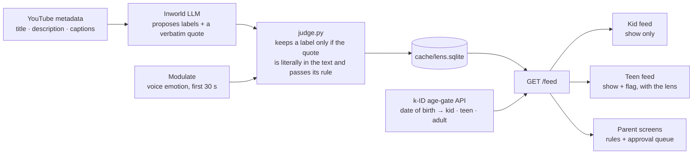

# SafeLens

**One video pool, three feeds by age.** Parents pick the 8-year-old's feed. 15-year-olds get the same videos with a *lens* that shows how each one tries to hook them, so they learn to spot it instead of being blocked.

Built in one day at the k-ID *Build for Everyone* hackathon (Oct 21, 2026). This repo is the API, the AI pipeline, the prompts, and the evaluation. The frontend lives in [`safelens-web`](https://github.com/COLE/safelens-web).

Live API: `https://safelens-api.onrender.com` · [API contract](API_SPEC.md) · [Design notes](CLAUDE.md)

---

## How it works



**The LLM proposes, code decides.** The model returns label candidates with a quote as evidence. `judge.py` keeps a label only when that quote is a literal substring of the video's title, description, or captions *and* it passes the label's rule. On our test set the judge dropped 31 of 51 proposals. Nothing a teen reads was written by the model alone.

**Six fixed tactics.** `fake_urgency` · `hidden_ad` · `body_image_pressure` · `engagement_bait` · `misleading_thumbnail` · `fake_social_proof`

**Teens are never blocked.** Harmful categories (gambling, violence, substances, private-contact recruiting, cosmetic procedures sold as quick fixes, dangerous challenges, money schemes) are shown with a *"What is wrong with this video"* box and flagged to the parent. Blocking only sends a 15-year-old to another app.

**Kids see only what the parent chose.** `show` = trusted channel, on topic, no hooks. `approve` = anything the parent should decide (a deny rule hit, off-topic, a product hook, an untrusted channel). `hide` = safety only.

## The three screens

| Screen | Call | What it returns |
| --- | --- | --- |
| Parent setup | `POST /parent/rules` with free text ("Science experiments, LEGO builds. No unboxing, nothing scary.") | allow/deny chips and a queue of every video with `show` / `approve` / `hide` and a one-line note |
| Kid feed | `GET /feed?dob=2015-04-15&jurisdiction=US-CA` | only `show` items |
| Teen feed | `GET /feed?dob=2011-01-01&jurisdiction=US-CA`, then `GET /video/{id}/lens` per card | every video; the lens gives 4 quiz chips, the kept tactics with their quotes, a reality check, and a `concern` box for flagged videos |

The age band comes from k-ID's server API (`age-gate/check-age-category`), never from the client. Every feed response carries `age_source: "k-id" | "fallback" | "client"`.

## Partner tools

| | Used for |
| --- | --- |
| **k-ID** | Date of birth → `digital-minor` / `digital-youth` / `adult` → kid / teen / parent screens. Parental-consent challenge verified in test mode. |
| **Inworld** | `openai/gpt-4o-mini` for every LLM step: video topics and kid risk, teen tactics with quotes, free-text parent rules, red-team baits. |
| **Modulate** | `velma-2` voice emotion on the first 30 s. Feeds the lens prompt and can confirm urgency or body pressure into a parent flag. Never adds a label. |

## Numbers

65 hand-labelled videos ([`tests/gold.json`](tests/gold.json)), scored by [`eval.py`](eval.py):

| | |
| --- | --- |
| Harmful teen content caught | 20 / 21 |
| Control videos over-labelled (news, debunks, disclosed reviews) | 0 / 10 |
| Overall | 60 / 65 = 92% |
| Evidence quotes verbatim | 100%, by construction |

Two blind holdout sets (31 fresh videos the rules never saw) produced zero false labels. An adversarial loop ([`pipeline/loop.py`](pipeline/loop.py)) has a red-team LLM write baits each round; its log is in [`data/loop_log.json`](data/loop_log.json).

## Run it

```bash
python -m venv .venv && source .venv/bin/activate
pip install -r requirements.txt
cp .env.example .env            # LLM_PROVIDER, INWORLD_API_KEY, INWORLD_MODEL, MODULATE_API_KEY, KID_API_KEY, KID_BASE_URL

python pipeline/build_pool.py   # data/raw -> data/videos.json
python pipeline/run_lens.py     # LLM proposals -> judge -> cache/lens.sqlite  (--rejudge re-applies rules with no LLM calls)
python pipeline/voice.py        # Modulate emotion for videos with audio
python eval.py                  # accuracy vs tests/gold.json
uvicorn api.main:app --reload   # http://localhost:8000
pytest -q                       # 103 tests
```

The API serves only from the committed cache, so it runs with no keys at all. Keys are needed only to rebuild the cache or to let `/feed` ask k-ID (without `KID_API_KEY` it falls back to a local date check and says so).

## Layout

```
api/main.py          the three endpoints, served from the cache
pipeline/build_pool  yt-dlp output -> videos.json
pipeline/llm         one LLM call, 20 s timeout, JSON only
pipeline/judge       the rules: quote check, six labels, verdicts, concerns
pipeline/rules       free-text parent rules (LLM proposes, rule-based fallback)
pipeline/age         k-ID age band with a local fallback
pipeline/voice       Modulate voice emotion
pipeline/run_lens    builds the cache
pipeline/loop        adversarial red-team rounds
prompts/*.txt        every prompt, as text
tests/               pytest, one file per module, plus gold.json
mock/                the exact JSON shapes the frontend builds against
```

## Team

Jiwon Bae (API, pipeline, eval) · Cole (frontend, design, pitch)
